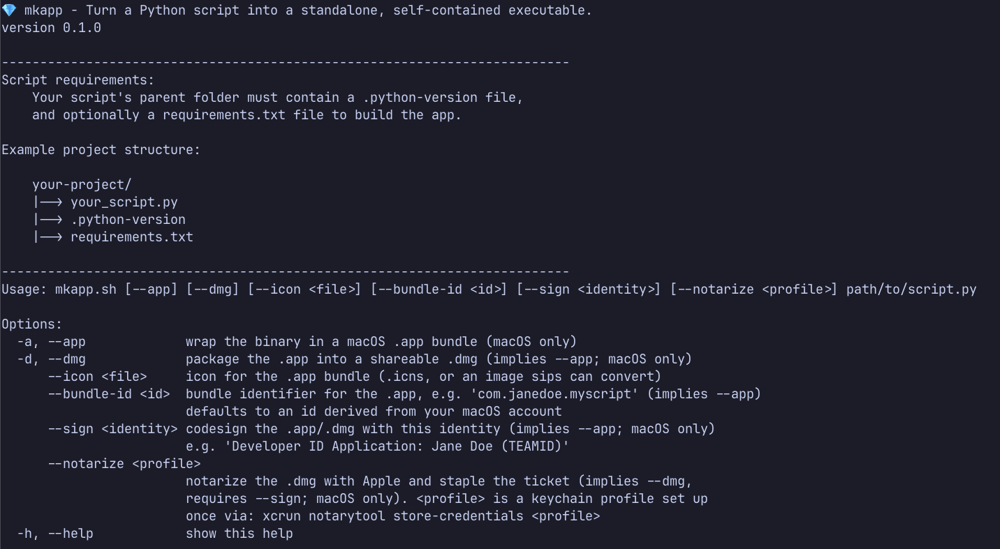
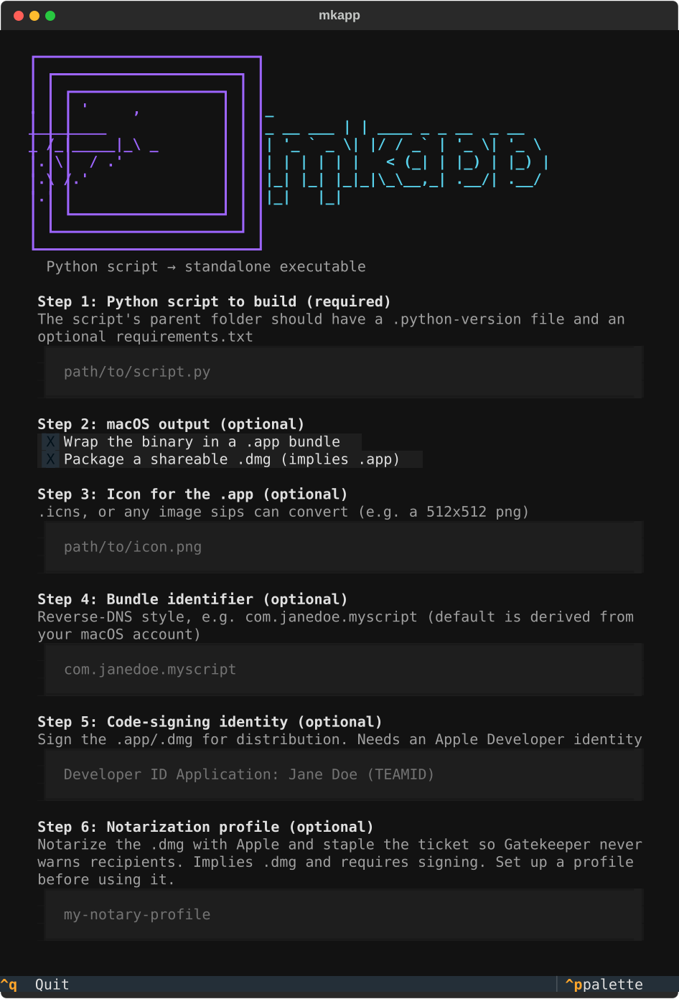
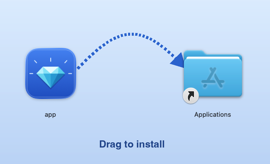

# mkapp

```text
┏━━━━━━━━━━━━━━━━━━━━━━━━━┓
┃ ┏━━━━━━━━━━━━━━━━━━━━━┓ ┃
┃ ┃ ┏━━━━━━━━━━━━━━━━━┓ ┃ ┃
┃ ┃ ┃  .     '     ,  ┃ ┃ ┃              _
┃ ┃ ┃    _________    ┃ ┃ ┃    _ __ ___ | | ____ _ _ __  _ __
┃ ┃ ┃ _ /_|_____|_\ _ ┃ ┃ ┃   | '_ ` _ \| |/ / _` | '_ \| '_ \
┃ ┃ ┃   '. \   / .'   ┃ ┃ ┃   | | | | | |   < (_| | |_) | |_) |
┃ ┃ ┃     '.\ /.'     ┃ ┃ ┃   |_| |_| |_|_|\_\__,_| .__/| .__/
┃ ┃ ┃       '.'       ┃ ┃ ┃                       |_|   |_|
┃ ┃ ┗━━━━━━━━━━━━━━━━━┛ ┃ ┃
┃ ┗━━━━━━━━━━━━━━━━━━━━━┛ ┃
┗━━━━━━━━━━━━━━━━━━━━━━━━━┛

  Python script → standalone executable
```

Turn a Python script into a standalone, self-contained executable with one command to bundle and build it all together, without leaving any dependencies behind.

`mkapp` bundles your Python script along with any dependencies used by your program into a single binary that runs on machines that may not have Python installed, unable to run Python scripts, or just as a way to easily share an executable instead of Python files. On macOS it can also produce an `.app` bundle and a shareable, optionally code-signed `.dmg` disk image.

<div align="center">
  
</div>

## How it works

`mkapp` wraps [uv](https://docs.astral.sh/uv/) and [PyInstaller](https://pyinstaller.org/) into a single command. It resolves your script's dependencies into an ephemeral environment that uv builds on the fly, collecting everything your application needs, hands everything to PyInstaller to compile into one binary, and cleans up after itself, leaving you with just the finished executable in a `dist/` folder next to your target script.

PyInstaller builds a binary for whatever platform you run it on. Run it on macOS to get a macOS binary, on Linux to get a Linux binary, and so on. **It does not cross-compile**.

When you build a macOS application with `--app`, PyInstaller builds the `.app` bundle itself, laying out every bundled library the way macOS expects. `mkapp` then layers your icon and bundle identifier on top. If you use the `--sign` arg, then each of those bundled libraries and the app itself, gets signed with your identity as PyInstaller collects them. Pass `--notarize` on top of that and `mkapp` submits the finished `.dmg` to Apple and staples the result, so recipients of your built application can bypass [Gatekeeper](https://support.apple.com/guide/security/gatekeeper-and-runtime-protection-sec5599b66df/web).

## Requirements

- **Bash**
- **[uv](https://docs.astral.sh/uv/)**
  - install with `curl -LsSf https://astral.sh/uv/install.sh | sh`. This is the only tool you have to install yourself. `uv` fetches PyInstaller, your dependencies, and the Python version your script uses when building.
- **Optional tools for macOS**
  - built-in macOS tools (`codesign`, `hdiutil`, `sips`) are used when the `--app` / `--dmg` / `--icon` args are passed. No extra install needed on a normal Mac. `--app` always runs `codesign` (ad-hoc if you don't pass `--sign`), so if it's ever missing, install the Xcode Command Line Tools (`xcode-select --install`).
  - `--notarize` additionally needs `notarytool` and `stapler`, which ship with the Xcode Command Line Tools (`xcode-select --install`) rather than the base OS.

## Install

To download and install `mkapp`, you can run the following:

```bash
curl -LsSf https://raw.githubusercontent.com/wfar/mkapp/main/install.sh | bash
```

This downloads `mkapp`, installs `uv` if it's missing, and adds a `mkapp` alias to your `~/.bashrc`/`~/.zshrc` so you can run `mkapp` from anywhere. Re-running the install script replaces its old block rather than adding another in your rc file, and saves a backup of the file first as `<file>.mkapp.bak`. Open a new terminal (or `source` your rc file) afterward.

Already have this repo cloned? Run `./install.sh` from the repo root instead. It installs in place rather than downloading a fresh copy.


## Usage

```bash
./mkapp.sh [--app] [--dmg] [--icon <file>] [--bundle-id <id>] [--sign <identity>] [--notarize <profile>] path/to/yourscript.py
```

When it finishes, your compiled executable is in a `dist/` folder next to your script, named after the script (minus the `.py`):

```text
path/to/dist/yourscript
```

### Options

| Option | Description |
| --- | --- |
| `-a`, `--app` | Wrap the binary in a macOS `.app` bundle. **macOS only.** |
| `-d`, `--dmg` | Package the `.app` into a shareable `.dmg` disk image with a drag-to `/Applications` layout. Implies `--app`. **macOS only.** |
| `--icon <file>` | Icon for the `.app` bundle. Accepts an `.icns` file, or any image that can be converted (e.g. a 512×512 `.png`). Ignored unless `--app` is set. |
| `--bundle-id <id>` | Bundle identifier (`CFBundleIdentifier`) for the `.app`, in reverse-DNS style, e.g. `com.janedoe.myscript`. Implies `--app`. If omitted, one is derived from your macOS account (`com.<your-username>.<scriptname>`). Pass your own to match a Developer ID/App ID you control, e.g. before signing for real distribution. |
| `--sign <identity>` | Code-sign the `.app` (and the `.dmg`, if built) with a signing identity from your keychain, e.g. `'Developer ID Application: Jane Doe (TEAMID)'`. Implies `--app`. Requires a valid Apple Developer identity and network access. **macOS only.** See [Sharing & signing](#sharing--signing-macos). |
| `--notarize <profile>` | Submit the `.dmg` to Apple's notary service and staple the ticket once approved, so Gatekeeper accepts it offline with no warning for anyone you share it with. Implies `--dmg`. Requires `--sign` (Apple only notarizes Developer ID-signed apps) and a keychain profile set up once via `xcrun notarytool store-credentials <profile>`. Submits over the network and blocks until Apple finishes processing, which is usually a few minutes. **macOS only.** See [Sharing & signing](#sharing--signing-macos). |
| `-h`, `--help` | Show usage. |

### Interactive mode

Run `mkapp` with **no arguments** in a terminal and it launches an interactive TUI that walks you through the same options step by step. You need to enter into the form the script path, `.app`/`.dmg` output, icon, bundle identifier, signing identity, and notarization profile:

```bash
./mkapp.sh
```

<div align="center">
  
</div>

### Example

This repo ships with example apps in `tests/` you can try:

```bash
# Simple terminal app that only uses standard library with no requirements.txt, the simplest possible build:
./mkapp.sh tests/stdlib_test/app.py
./tests/stdlib_test/dist/app

# Terminal app which uses the 'requests' library demonstrates dependency bundling:
./mkapp.sh tests/terminal_test/app.py
./tests/terminal_test/dist/app

# GUI app which creates a simple PyQt6 window to demonstrate GUI/windowed builds:
./mkapp.sh tests/gui_test/app.py
./tests/gui_test/dist/app

# (macOS) Can build a double-clickable macOS app instead with an app icon:
./mkapp.sh --app --icon resources/sample-icon.png tests/terminal_test/app.py
open ./tests/terminal_test/dist/app.app

# (macOS) Build a shareable disk image with optional signing for distribution:
./mkapp.sh --dmg --icon resources/sample-icon.png tests/terminal_test/app.py
./mkapp.sh --dmg --sign "Developer ID Application: Jane Doe (TEAMID)" tests/terminal_test/app.py

# (macOS) Notarize your app, so Gatekeeper does not flag it with a warning when distributed:
./mkapp.sh --dmg --sign "Developer ID Application: Jane Doe (TEAMID)" --notarize "my-notary-profile" tests/terminal_test/app.py
```

## Required application project structure

The script that you are targeting for your build should exist with a file structure that looks like the following:

```text
project-directory/
├── .python-version     # e.g. 3.12
├── requirements.txt    # optional dependencies
└── script.py           # script to convert to an executable
```

### Declaring dependencies

`mkapp` looks for a **`requirements.txt`** next to your script and installs those dependencies into the build environment. Pure standard library scripts do not need it, however.

If you declare dependencies in a `pyproject.toml` or some other dependencies management file, convert it to a `requirements.txt` first. `mkapp` currently only supports `requirements.txt` files for listing dependencies.

### Choosing the Python version

`mkapp` builds with the Python version declared in a **`.python-version`** file in the same folder as your script. This is the Python version PyInstaller bundles into your executable. Pinning it keeps every build of your script on the same version. The file is required and without one, `mkapp` stops before building. Only the script's own folder is checked, so the version can't change depending on where you run `mkapp` from.

## Building macOS apps for distribution

`mkapp` can be used to build, sign, and notarize your application so that it can be easily shared with other mac users. `mkapp` allows you to build a `.dmg` disk image, sign it with a valid Apple Developer ID, and notarize it with Apple.

### Build a disk image

To share or distribute your macOS app with someone else, build a disk image with `--dmg`. This will create a single, compressed, read-only .dmg file that opens a simple "Drag to install" window when installing your newly built macOS app.
> [!NOTE]
> Creating a .dmg with a background requires a Finder session on the machine you are building on. Otherwise, the `.dmg` created will be a basic install window.

```bash
./mkapp.sh --dmg path/to/yourscript.py   # dist/yourscript.dmg
```

<div align="center">
  
</div>

### Signing your application

Signing your app is optional but recommended for distribution. Every `.app` that `mkapp` builds is signed, which is enough to run on your own Mac. However, an ad-hoc signature has no identity, so unsigned apps still trip [macOS Gatekeeper](https://support.apple.com/guide/security/gatekeeper-and-runtime-protection-sec5599b66df/web) for anyone else trying to use your app. To avoid that, pass `--sign` with a [Developer ID Application](https://developer.apple.com/help/account/certificates/create-developer-id-certificates) identity from your keychain (requires an [Apple Developer](https://developer.apple.com/) account):

```bash
./mkapp.sh --dmg --sign "Developer ID Application: Jane Doe (TEAMID)" path/to/yourscript.py
```

> [!NOTE]
> To find your Apple Developer ID, you can view the list of all the identities available for code-signing on your machine with:
> ```bash
> security find-identity -v -p codesigning
> ```

`mkapp` signs the `.app`, the `.dmg`, and every library PyInstaller bundled inside with your application, all with your identity, hardened runtime, and a secure timestamp, so the result is **notarization-ready**.

### Notarizing with Apple's notary service

To allow for a seamless distribution of your app, without Gatekeeper warnings, add `--notarize`. It submits the `.dmg` to Apple's notary service, waits for approval, and staples the ticket onto the `.dmg` automatically, so users of your application get a pass from Gatekeeper when installed on their machine:

```bash
./mkapp.sh --dmg --sign "Developer ID Application: Jane Doe (TEAMID)" --notarize "<profile>" path/to/yourscript.py
```

> [!NOTE]
> `<profile>` is a keychain profile holding your Apple credentials, which you can set up with:
> ```bash
>xcrun notarytool store-credentials <profile>
>```
>
>It'll prompt you interactively for your Apple ID, an [app-specific password](https://support.apple.com/en-us/102654), and your Team ID. From then on, any `mkapp` build can reuse that same profile name. You never need to provide credentials or secrets directly to `mkapp.sh`.

Notarizing submits your application to Apple's servers, so it needs network access and typically takes a few minutes. `mkapp` blocks until it's done rather than leaving you to check back later, then staples the returned ticket to your `.app`/`.dmg`.

### Verifying your build is ready for distribution

After stapling, `mkapp` re-checks the `.dmg` and the `.app` inside it the same way Gatekeeper and Apple's notary service would on a recipient's Mac. Any failure stops the build immediately, so a broken signature, an unstapled ticket, or a bad nested dependency is caught right away instead of surfacing later as a Gatekeeper warning for someone else.

## Development

To develop and modify `mkapp`, clone the repo locally. Working on `mkapp` itself requires `uv`. Everything required for development is declared in [`pyproject.toml`](pyproject.toml). Run the following to set it all up:

```bash
git clone https://github.com/wfar/mkapp.git
cd mkapp
make install
```

`make install` creates a local `.venv` with the all dev dependencies required and installs the pre-commit hooks that run the formatting, linting, and security checks. To add or change a dependency, edit `pyproject.toml` and run `uv lock`.

### Tasks

For ease of developing, all dev tasks run through [`make`](Makefile). Run `make` with no arguments to see a list of all the commands possible. If any new dev workflows come up, they should go here.

### Tests

Tests for the code can be run to verify that `mkapp` works as expected. You can run either the full test suite, which covers the entire build process for `mkapp`, or quick tests, that run validation and basic verification tests.

To run the full test suite, call the following command:

```bash
make test
```

To run the quick tests, call the following command:

```bash
make test ARGS=--quick
```

It also accepts `--sign <identity>` and `--notarize <profile>` (which needs `--sign` too) to exercise the macOS signing and notarization paths, which are skipped unless you pass them:

```bash
make test ARGS='--sign "Developer ID Application: Jane Doe (TEAMID)" --notarize my-notary-profile'
```

## License

`mkapp` is licensed under the [GNU General Public License v3.0 or later](LICENSE), with the [mkapp Output Exception](LICENSE-EXCEPTION). Files `mkapp` places into your builds (executables, `.app` bundles, `.dmg` images) can be distributed under any terms, and `mkapp`'s license never applies to the programs you build with it.
